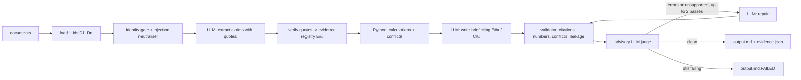

# Veritas

**An evidence-cited stock research agent that checks its own work.** Give it an NSE ticker and a folder of scraped documents; it writes a one-page brief (Snapshot, Bull case, Bear case, Open questions, Sources) in which every factual sentence cites a verbatim quote, and every number is verified by code before the brief is accepted.

## Why it is built this way
A language model can write a fluent research note. The hard part is knowing which sentences to trust, so Veritas treats the model as an untrusted component and puts deterministic checks around it:

- **Quotes are verified, not believed.** The model proposes claims with verbatim quotes; code locates each quote in the source, rejects invented text or numbers, and rejects values read from the wrong table column or period.
- **Numbers come from Python.** Growth, margin change, pledge as a share of total shares and similar figures are computed in code, not by the model.
- **Disagreement is surfaced.** Cross-source conflicts (for example a news report saying ₹1,428 crore against a filing saying ₹1,248 crore) are detected by code and the brief must disclose them.
- **Hostile documents are expected.** A look-alike company is excluded by an identity gate; instruction-like text planted in a document is redacted before the model sees it, and the output validator is the backstop.
- **Failure is loud.** A brief that still has errors after two repair passes is written to `output.md.FAILED`, never to `output.md`.



Details: [docs/architecture.md](docs/architecture.md) · design decisions: [docs/decisions/](docs/decisions/) · requirements traceability: [docs/requirements.md](docs/requirements.md).

## Quick start
Python 3.11 or newer.
```bash
python3 -m venv .venv && source .venv/bin/activate
pip install -r requirements.txt && pip install -e . --no-deps
python -m pytest -q                                   # offline suite: no network, no key
python -m veritas.mcp_client SRVCABLE .               # screens the corpus over a real MCP stdio server; no key needed
```
To generate a brief you need a model:
```bash
cp .env.example .env     # set SRV_PROVIDER=anthropic and ANTHROPIC_API_KEY, or SRV_PROVIDER=claude-cli
python -m veritas SRVCABLE research_pack --out output.md --artifacts runs/latest
```
Providers: `anthropic` (needs `ANTHROPIC_API_KEY`) or `claude-cli` (a logged-in `claude` CLI with tools disabled; no key). `.env` is git-ignored and is never logged. Recorded runs used **claude-sonnet-5-5**, which rejects `temperature`, so output varies slightly between runs.

Exit codes: `0` validation passed · `1` validation failed (brief saved as `output.md.FAILED`; see `run.json`) · `2` input, LLM or extraction error. A live run takes about 100 s (3 to 6 LLM calls; token usage is in `run.json`). Useful flags: `--mode baseline|structured|robust` (default `robust`), `--engine classic|graph`, `--no-entailment`, `--quiet`.

## Ways to use it
| Interface | What it is | Install extra | Entry point |
|---|---|---|---|
| CLI | the pipeline, with streamed progress | none | `python -m veritas` |
| LangGraph engine | robust mode as a state graph with checkpoints | `graph` | `--engine graph`, `veritas.graph.run_graph` |
| HTTP API | background jobs, SQL persistence, stats | `api` (`postgres` for Postgres) | `veritas-api` |
| MCP server | four tools over stdio for any MCP client | `mcp` | `veritas-mcp` |
| MCP client | starts and calls the server | `mcp` | `python -m veritas.mcp_client` |
| LangChain | the MCP tools as LangChain tools, plus an agent | `langchain` | `veritas.langchain_tools` |
| Evaluation | repeated runs, judge agreement | none (graph engine optional) | `veritas-eval` |

Install what you need with `pip install -e '.[api]'` (or `graph`, `mcp`, `langchain`, `postgres`; combine with commas). The core pipeline imports none of them, and tests of an extra skip themselves when it is not installed.

### LangGraph engine
The same robust pipeline as a `StateGraph` in `src/veritas/graph.py`: typed state, one node per stage, conditional edges for the evidence abort and the bounded judge/repair loop, and a checkpointer that records the state after each node. It calls the same functions, prompts and thresholds as the classic engine; tests assert identical briefs, validation issues, prompts, LLM-call counts and repairs across eight scripted scenarios.
```bash
python -m veritas SRVCABLE research_pack --engine graph --out output.md
```
```python
from langgraph.checkpoint.memory import InMemorySaver
from veritas.graph import run_graph, build_graph, node_trace
saver = InMemorySaver()
res = run_graph("SRVCABLE", "Sarvottam Cables Ltd", "research_pack", llm, thread_id="demo", checkpointer=saver)
node_trace(build_graph(llm, checkpointer=saver), "demo")   # step-by-step state of that run
```
The node and edge diagram is in [docs/architecture.md](docs/architecture.md); the trade-offs (what the framework gave, what it cost) are in [ADR 009](docs/decisions/009-langgraph-engine.md).

### HTTP API
`POST /briefs` returns `202` and a `run_id`; the job runs in the background and is stored in SQL, so results survive restarts.

| Endpoint | Purpose |
|---|---|
| `POST /briefs` | queue a run `{ticker, company, docs_dir, use_entailment, engine}` |
| `GET /briefs/{id}` | status (`queued`, `running`, `done`, `failed`), brief, errors and warnings, counts |
| `GET /briefs/{id}/evidence` | evidence registry, calculations, conflicts (`409` until done) |
| `POST /briefs/{id}/validate` | deterministic re-check of an edited brief against that run's registry; no LLM |
| `GET /briefs`, `GET /stats` | past runs; pass rate, repair histogram, top validation error codes |
| `GET /healthz` | liveness plus a database check |

```bash
pip install -e '.[api]' && veritas-api            # http://127.0.0.1:8000/docs (OpenAPI)
curl -s localhost:8000/briefs -H 'content-type: application/json' \
  -d '{"ticker":"SRVCABLE","company":"Sarvottam Cables Ltd","docs_dir":"."}'
```
Configuration (environment): `VERITAS_DATABASE_URL` (default `sqlite:///veritas.db`; for Postgres `postgresql+psycopg://user:pw@host/db`), `VERITAS_DOCS_ROOT` (default `research_pack/`; `docs_dir` must stay inside it), `VERITAS_HOST`, `VERITAS_PORT`, `VERITAS_LOG_LEVEL`. The schema is created by Alembic migrations on startup. Logs are one JSON object per line and carry ids and counts, never documents, prompts or keys. **There is no authentication**: run it behind a gateway.

Docker (`Dockerfile`, `docker-compose.yml`: API plus Postgres 16 with health checks):
```bash
export ANTHROPIC_API_KEY=...        # read from your shell; not baked into the image
docker compose up --build
```
These two files were written but **not built or run** on the machine used for development (no Docker there), and Postgres was not tested; the API itself was run under uvicorn with SQLite.

### MCP server and client
`veritas-mcp` serves four tools over stdio: `screen_documents` (identity gate and injection scan, no LLM), `build_brief` (runs the graph engine and returns a `run_id`), `get_evidence` (registry, calculations and conflicts of a run) and `validate_brief` (re-check an edited brief, no LLM).
```bash
pip install -e '.[mcp]'
claude mcp add veritas --env VERITAS_DOCS_ROOT=$PWD/research_pack --env SRV_PROVIDER=claude-cli -- $PWD/.venv/bin/veritas-mcp
```
`docs_dir` is relative to `VERITAS_DOCS_ROOT` (default `research_pack/`) or absolute inside it; `..`, symlink escapes and missing directories are returned as tool errors. Domain errors are mapped to clean tool errors. Runs are kept in memory (newest 20). `mcp` is pinned to 1.30.0 because 2.x renames `FastMCP` to `MCPServer`.

`python -m veritas.mcp_client SRVCABLE .` starts the server as a subprocess, lists its tools and prints the screening table; add `--build` to build a brief and re-validate it. The child process gets a minimal environment; pass settings with `--pass-env NAME`.

### LangChain agent
`veritas.langchain_tools.langchain_tools(server)` wraps the MCP tools as LangChain `StructuredTool`s (they call the same server object, so path confinement and error mapping are shared) and `build_agent(server, chat_model)` builds a `langchain.agents.create_agent` tool-calling agent. Tool errors reach the model as messages. Any tool-calling chat model works; `langchain-anthropic` is not a dependency because its current release needs a newer `anthropic` SDK than the pinned `0.111.0`. The tests drive the agent with a scripted chat model.

### Evaluation tool
`veritas-eval` reports measurements and labels where they come from.
```bash
veritas-eval repeat --scenario flaky -n 20 --seed 0     # simulated stand-in model: checks the harness and the repair loop
veritas-eval repeat --live -n 10                         # the real model on the real corpus (needs a provider)
veritas-eval judge --run runs/round2/r5_a --judge live   # LLM judge vs labelled wrong-citation rewrites of a stored brief
```
`repeat` reports pass rate with a 95% Wilson interval, mean and std of repairs, calls, seconds, words and evidence, run-to-run consistency of cited evidence, and failures grouped by validator code. `judge` rewrites each cited sentence of a stored brief to cite an unrelated item (wrong by construction) and compares the judge and the deterministic validator on the same cases. Simulated results are not a measurement of any model.

## Results so far
All numbers come from [docs/evaluation.md](docs/evaluation.md), which also lists the failures found along the way.

- **Live, classic engine:** nine runs on the one corpus passed validation (three sets of three) after the fixes that earlier failures motivated; this is not a reliability estimate. The delivered brief ([runs/round2/r5_a](runs/round2/r5_a)) had 0 validation errors, 0 repairs and 3 LLM calls.
- **Adversarial:** two paraphrased injections written to evade the scanner were run live against the real and a naive system prompt (4 runs): all content checks passed (24/24) and validation passed 4/4. The model resisted both on its own; the scripted tests exercise the code defences with a model that does obey.
- **Offline:** 136 tests pass (76 pass and 9 skip without the optional extras); coverage 92%; ruff clean.
- **Deterministic validator vs wrong citations:** on the stored brief `r5_a`, it flagged 17 of 24 sentences rewritten to cite an unrelated item; the 7 it missed have no number to bind. The LLM judge's side of this comparison has not been run.

## Project layout
```
src/veritas/
  loader.py identity.py injection.py     ingestion, look-alike gate, instruction redaction
  evidence.py calc.py                    verbatim-quote registry, deterministic calculations, conflicts
  validate.py entail.py                  per-sentence validator; advisory entailment judge
  pipeline.py graph.py                   classic engine; LangGraph engine (same helpers)
  render.py cli.py llm.py                sources section; CLI; providers, retry, scripted test model
  api.py db.py migrations/ paths.py      HTTP API; SQL persistence; Alembic; path confinement
  mcp_server.py mcp_client.py            MCP server and client
  langchain_tools.py evalkit.py sim.py   LangChain adapter; veritas-eval; scripted fixtures
prompts/            stage prompts (system, extract, synthesize, entail, repair)
research_pack/      the eight sample documents
tests/              offline suite; test_live.py is opt-in
scripts/            demo, gold-set table, live adversarial runs
docs/               architecture, requirements, evaluation log, ADRs 001 to 010
```

## Testing
```bash
python -m pytest -q                       # offline, scripted model
python -m pytest -q --cov=veritas         # with coverage (pytest-cov is in requirements.txt)
python -m pytest -m live -q               # live-model integration; needs a provider
python scripts/evaluate.py runs/round2/r5_a runs/round2/r5_b runs/round2/r5_c   # gold-set table
PYTHONPATH=src python scripts/adversarial_live.py [naive]                       # live injection runs
FAST=1 bash scripts/demo.sh               # about 2 minutes: live run with streamed progress (writes to runs/demo/)
```

## Troubleshooting
- `ANTHROPIC_API_KEY is not set`: fill `.env`, or use `SRV_PROVIDER=claude-cli`.
- `validation FAIL`: read `issues` in `run.json`; the brief is still written to `output.md.FAILED` for inspection.
- `extraction: output truncated`: raise `max_tokens` in `llm.py`; complete items are kept.
- `--engine graph` says it needs the extra: `pip install -e '.[graph]'`.
- API returns `422` for `docs_dir`: it must be inside `VERITAS_DOCS_ROOT`.

