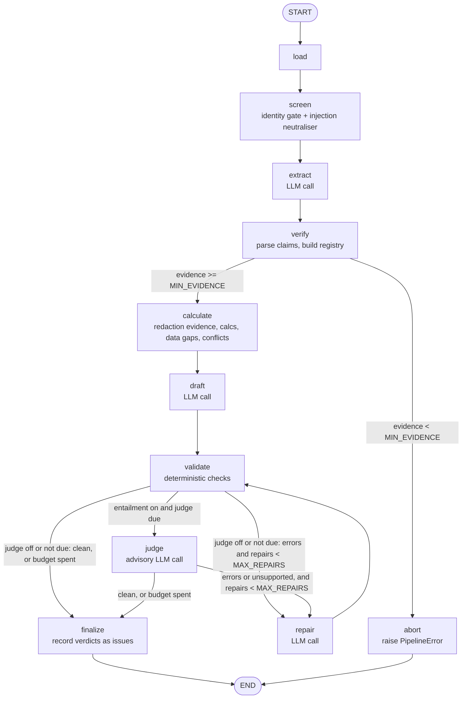

# Architecture

```
ticker + dir
  -> loader        (discover, parse front matter, D1..Dn ids, never drop silently)
  -> identity      (ticker / legal name / name-stem gate; different legal forms and look-alikes excluded;
                    exclusion markers derived from the excluded documents)
  -> injection     (neutralise instruction-like text after Unicode normalisation, line numbers preserved;
                    each redaction becomes a citeable evidence item)
  -> LLM: extract  (JSON claims, each with a verbatim quote)
  -> evidence      (quote located in source => E## + line range; value must appear in quote; quote >= 12 chars;
                    table values must sit under the claimed period column; fewer than 8 items => abort)
  -> calc          (Python: growth, margin bps, pledge-of-total, capex remaining, GST vs profit, implied upside,
                    data-gap check "not in the sources")
  -> conflicts     (same metric+period across docs; stale vs new; reported vs computed growth; de-duplicated)
  -> LLM: synthesise (cites only E##/C##; every sentence cited or labelled "Our view:")
  -> validate      (sections, length, per-sentence citation, whole-number support, metric-family binding,
                    conflict disclosure, excluded-company leakage, unattributed recommendations, "unsourced")
  -> LLM: entailment judge (advisory)  -> up to 2 repair passes on deterministic errors or "unsupported"
  -> render        (compact Sources by code; quotes stay in evidence.json; failures go to output.md.FAILED)
```

Modes (same model, same corpus) isolate design changes:
- `baseline`: one call over all raw documents, citations as `[D#:L#]`. Same validator, but no registry/gates.
- `structured`: extraction -> registry -> calc/conflicts -> synthesis. No identity/injection handling, no repair.
- `robust`: structured + identity gate + injection neutralisation + reliability guidance + advisory entailment judge + up to two repair passes.

Modules: `src/veritas/{loader,identity,injection,evidence,calc,validate,pipeline,graph,mcp_server,render,llm,cli}.py`. Prompts live in `prompts/`, separate from logic. Provider code is confined to `llm.py` (Anthropic SDK; `claude` CLI; scripted test double).

## Source-assessment policy
Applied by the model under `prompts/system.md`, with deterministic support: who is speaking (filing vs transcript vs news vs tip blog), date versus a reporting period, claim type (fact / management statement / forecast / allegation / opinion), corroboration across documents, company identity. Official statements are not assumed true (the GST "no material impact" line is labelled the company's own view); news is not assumed false. Sentiment is never used as reliability.

## Trust boundaries
Documents are untrusted data wrapped in `<document>` tags; the model has no tools; closing-tag spoofing is escaped; suspected injections are replaced before the model sees them (best effort); output validation is the backstop. The scanner is pattern-based and is treated as telemetry: two paraphrased attacks written to evade it were run live and were not obeyed, but that resistance is largely the model's.

## Graph engine (`graph.py`)
`--engine graph` runs the robust configuration as a LangGraph `StateGraph` instead of the straight-line code in `pipeline.run`. The nodes call the same functions (`screen`, `build_registry`, `calculate`, `validate_brief`, `entail.judge`, the prompt builders), so the two engines differ only in control flow. State is one typed dict (`VeritasState`); a checkpointer stores it after every node.


The judge is due on the first draft, and after a repair only when validation is clean or the repair budget (`MAX_REPAIRS`) is spent; `--no-entailment` never routes to it. `abort` and `finalize` exist because the classic code raises and post-processes inline; as nodes they appear in the checkpoint history. Redaction evidence is added at the start of `calculate`, not in `screen`, because evidence ids are assigned after the registry is built and the abort check counts only verified claims.

## MCP server (`mcp_server.py`)
Four tools over stdio (`screen_documents`, `build_brief`, `get_evidence`, `validate_brief`). `build_brief` runs the graph engine and keeps the final state under a `run_id`; the other two tools read it. `docs_dir` is resolved (symlinks included) and must stay inside `VERITAS_DOCS_ROOT`. Domain errors (`LoadError`, `LLMError`, `PipelineError`) become tool errors.
